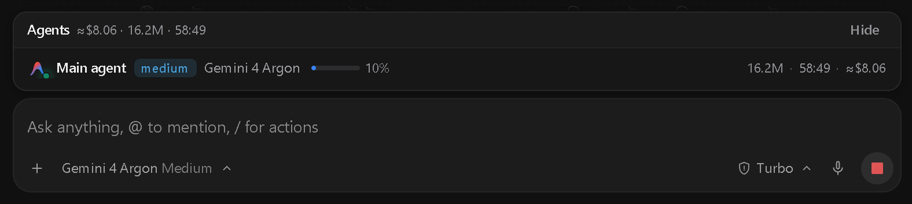

# Antigravity Agent Panel

Real-time **Native DOM Agent & Subagent Token Telemetry Panel** for **Google Antigravity 2.0**.



## Overview

**Antigravity Agent Panel** attaches directly above the chat input box inside Google Antigravity 2.0, giving you live visibility into your main agent and subagents with **zero LLM token overhead** (no slash commands or `@` mentions required).

### Key Features

- **100% Native DOM Integration**: Embedded directly above `#antigravity.agentSidePanelInputBox` inside Antigravity's chat layout. It moves and resizes automatically whenever the chat column shifts left, center, or right (e.g., when opening file trees, side panels, or code editors).
- **Never Floats Over Other Apps**: Unlike OS-level floating overlays, it lives strictly inside Antigravity's DOM and never blocks the `+` (`Add context`) attachment popup menu.
- **Live Main Agent + Multi-Subagent Tracking**:
  - Displays the **Main agent** row with official Google Antigravity branding, effort badge (`light`, `medium`, `careful`, `heavy`), active model (`Gemini 4 Argon`, `Gemini 3.8 Flash`, etc.), context window usage bar (`%`), total tokens, active duration, and estimated cost (`≈$`).
  - Automatically expands to show a separate live row for each running **Subagent** (with its role badge, Gemini model, tokens, elapsed time, and cost) while subagents are working, and automatically collapses back to the single **Main agent** row as soon as all subagents finish.
- **Automatic Lifecycle**: Opens automatically when a prompt or agent task runs and auto-hides after inactivity or in empty new chats.
- **Cross-Platform & Zero Dependencies**: Built with pure Node.js (`>=18.0.0`) with automatic startup registration for **Windows**, **macOS**, and **Linux**.

---

## Quick Install (Windows / macOS / Linux)

Make sure **Node.js (v18+)** is installed, then run:

```bash
git clone https://github.com/mdnaeem-28/antigravity-agent-panel.git
cd antigravity-agent-panel
node install.js
```

That's it! `node install.js` immediately starts the background telemetry daemon (`http://127.0.0.1:4747`), injects the native Agent Panel into all open Google Antigravity windows, and registers auto-start on system login.

---

## Uninstall

To stop the panel and remove the startup entry at any time:

```bash
node uninstall.js
```

---

## বাংলায় নির্দেশিকা (Bengali Guide)

**Antigravity Agent Panel** গুগল অ্যান্টিগ্রাভিটি ২.০ (Google Antigravity 2.0)-এর প্রম্পট বক্সের ঠিক উপরে স্থায়ীভাবে যুক্ত হয়ে মেইন এজেন্ট এবং সাব-এজেন্টগুলোর লাইভ টোকেন ব্যবহার, কনটেক্সট লিমিট (`%`), সময় এবং আনুমানিক খরচ (`≈$`) দেখায়। এটি চালাতে কোনো স্ল্যাশ কমান্ড (`/`) বা মেনশন (`@`) করার প্রয়োজন নেই—প্রম্পট দিলেই স্বয়ংক্রিয়ভাবে কাজ করে।

### ইনস্টল করার নিয়ম:
টার্মিনাল বা পাওয়ারশেলে নিচের ৩টি কমান্ড রান করুন:

```bash
git clone https://github.com/mdnaeem-28/antigravity-agent-panel.git
cd antigravity-agent-panel
node install.js
```

আনইনস্টল করতে চাইলে:
```bash
node uninstall.js
```

---

## Credits & License

- Created by **Md. Naeem** ([@mdnaeem-28](https://github.com/mdnaeem-28))
- Inspired by [`claude-agent-panel`](https://github.com/mshadmanrahman/claude-agent-panel)
- Licensed under the [MIT License](LICENSE)
